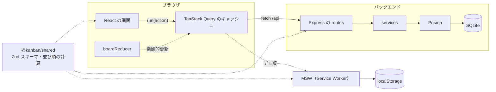

# かんばんボード

React 19 と TypeScript で作った、Trello のようなかんばんボードです。React を学ぶための教材として、設計から完成までを6つのステップに分けて作っています。

[](https://github.com/kiyohara1021/kanban-board/actions/workflows/ci.yml)
[](https://github.com/kiyohara1021/kanban-board/actions/workflows/pages.yml)
[](LICENSE)


**デモ：https://kiyohara1021.github.io/kanban-board/**

インストールせずに、ブラウザですぐに試せます。デモ版ではサーバーの代わりにブラウザの中で API を動かしているため、操作した内容はお使いのブラウザの中だけに保存され、ほかの人と共有されることはありません。


## 特徴

- カードとカラムの追加・編集・削除、ドラッグ&ドロップでの並び替え（マウス・タッチ・キーボードに対応）
- ボードの一覧と、URL で直接開けるカード詳細（URL を共有でき、再読み込みしても開いたままになります）
- ボードごとに作れる色付きのラベル。カード詳細で作成・削除し、カードに付け外しできます
- カードの期限日。期限を過ぎたカードは、色に加えてアイコンと「期限切れ」の文字で目立たせます
- カードの検索・絞り込み（タイトルと説明の文字、ラベル）。条件は URL に残るので、再読み込みや共有ができ、絞り込んだまま並び替えもできます
- 操作はすぐ画面に反映され、サーバーへの保存は裏側で行います（楽観的更新）。保存に失敗したときは元の状態に戻し、エラーをお知らせします
- キーボード操作、スクリーンリーダーでの読み上げ、日本語入力（変換を確定する Enter）に配慮しています
- フロントエンド・バックエンド・共有パッケージのテストを、Node.js 24 と 26 の CI で毎回実行しています

<details>
<summary>カード詳細の画面</summary>


</details>

## 技術スタック

| 分類              | 採用技術                                         | 選んだ理由                                                                                |
| ----------------- | ------------------------------------------------ | ----------------------------------------------------------------------------------------- |
| フロントエンド    | React 19 / TypeScript / Vite                     | 現在の標準的な構成で、参考になる資料が多いため                                            |
| UI                | Tailwind CSS v4 / shadcn/ui（Radix）             | 部品のコードがリポジトリの中に置かれるので、読んで学べるうえ、自由に手を加えられるため    |
| サーバーの状態    | TanStack Query                                   | データの取得・キャッシュ・再取得・楽観的更新を任せられるため                              |
| ルーティング      | React Router v8                                  | 子ルートを使ってカード詳細を URL で表せるうえ、ページごとにファイルを分けて読み込めるため |
| エラー処理        | react-error-boundary                             | 描画中のエラーを受け止める部品を、クラスコンポーネントを書かずに使えるため                |
| ドラッグ&ドロップ | dnd-kit（`@dnd-kit/core` / `sortable`）          | 安定版で、キーボード操作と読み上げに対応しているため                                      |
| バックエンド      | Express 5 / Prisma 7 / SQLite（libsql）          | 下の補足を参照                                                                            |
| 共通              | Zod（`@kanban/shared`）                          | 入力チェックのルールと型を、フロントエンドとバックエンドで1か所にまとめられるため         |
| テスト            | Vitest / React Testing Library / Supertest / MSW | 関数・画面・API を、それぞれ実際の使われ方に近い形でテストできるため                      |
| 品質管理          | oxlint / Prettier / GitHub Actions / Dependabot  | 下の補足を参照                                                                            |

**バックエンドの補足**

- Express 5：非同期の処理の中で起きたエラーを、自動でエラー処理に渡してくれます
- Prisma 7：データベースの操作に型が付き、書き間違いに気づきやすくなります
- SQLite：ファイル1つで動くので、データベースのサーバーを用意する必要がありません

**品質管理の補足**

- oxlint と Prettier：高速なコードチェックと、自動の整形を行います
- GitHub Actions：Node.js 24 と 26 の両方でテストとビルドを実行し、デモ版を GitHub Pages に公開します
- Dependabot：依存パッケージの更新を自動で提案します

## 設計で工夫したところ

### 1つの reducer を3つの場面で使い回す

カードの追加や移動など、ボードへの変更はすべて `boardReducer` のアクションとして表しています。アクションの形を API に合わせておいたことで、同じ reducer を次の3つの場面で使えるようになりました。

1. **Step 2〜3**：画面の状態を `useReducer` で管理する
2. **Step 5**：API の結果を待たずにキャッシュを書き換える（楽観的更新）。失敗したときは元に戻す
3. **ドラッグ中**：別のカラムへの移動を、ドロップする前から画面に表示する

コンポーネントからは `run(action)` を呼ぶだけで、表示の更新と API の呼び出しがまとめて行われます（[useBoardAction.ts](frontend/src/features/boards/useBoardAction.ts)）。

### ルールをフロントエンドとバックエンドで共有する

文字数の上限などの入力ルールは、Zod のスキーマとして `shared/` に1か所だけ書いています。バックエンドはリクエストのチェックに、フロントエンドは型とフォームの入力制限に、同じスキーマを使います。並び順の計算（[position.ts](shared/src/position.ts)）も共有しているので、ドラッグ中の画面の並びと、保存される並びが必ず一致します。

### 並び順を小数で持つ

カードの並び順は 1000、2000、3000… のような数値で持ち、間に差し込むときは前後の中間の値（1500 など）を使います。こうすると、移動のたびに書き換えるのは動かしたカード1枚分だけで済みます。間隔が狭くなりすぎたときだけ、まとめて番号を振り直します。

### キーボードと日本語入力に対応する

- ドラッグ&ドロップは、Space キーで持ち上げ、矢印キーで動かし、もう一度 Space キーで置けます。隣のカラムへの移動、置いたあとのフォーカスの位置、日本語での読み上げにも対応しています
- 名前の変更などで Enter キーを扱うときは、日本語入力で変換を確定するための Enter に反応しないようにしています

### デモ版ではブラウザの中で API を動かす

GitHub Pages ではサーバーを動かせません。そこでデモ版では、[MSW](https://mswjs.io/) の Service Worker が `/api` へのリクエストを受け取り、`localStorage` をデータベースの代わりにして、本物と同じ API を再現しています（[frontend/src/demo/](frontend/src/demo/)）。アプリ本体のコードはデモ版と通常版で共通で、通常版のビルドには MSW を含めていません。

## 構成



```
kanban-board/
├── frontend/      React アプリ（Vite の react-ts テンプレートから作成）
├── backend/       API サーバー（Prisma 公式の Express テンプレートから作成）
├── shared/        フロントエンドとバックエンドで共有する Zod スキーマ・型・並び順の計算
├── docs/          設計ドキュメントと画像
├── .github/       CI、GitHub Pages への公開、Issue / PR テンプレート、Dependabot
├── AGENTS.md      AI エージェント向けの説明（CLAUDE.md と .github/copilot-instructions.md からも参照）
└── package.json   npm workspaces のルート
```

## ローカルで動かす

Node.js 24 以上が必要です。推奨は最新の LTS である 26 です（`.nvmrc` に書いてあります）。nvm や fnm をお使いの場合は、`nvm use` などで切り替えられます。

```bash
npm install
npm run db:migrate -w backend   # 初回だけ。SQLite のデータベース（backend/prisma/dev.db）を作ります
npm run db:seed -w backend      # サンプルのボードを入れます（実行するたびにサンプルの状態に戻ります）
npm run dev                     # フロントエンドとバックエンドを同時に起動します
```

起動したら、http://localhost:5173 を開いてください。

| コマンド                       | 内容                                                                        |
| ------------------------------ | --------------------------------------------------------------------------- |
| `npm test`                     | 3つのパッケージのテスト（Vitest。バックエンドは Supertest で API をテスト） |
| `npm run build`                | フロントエンドのビルドと、3つのパッケージの型チェック                       |
| `npm run build:demo`           | GitHub Pages 用のデモ版のビルド（`frontend/dist` に出力）                   |
| `npm run lint`                 | コードのチェック（oxlint）                                                  |
| `npm run format`               | コードの整形（Prettier）。整形が必要かどうかの確認だけなら `format:check`   |
| `npm run db:studio -w backend` | データベースの中身をブラウザで見る（Prisma Studio）                         |

デモ版を手元で確認するときは、`npm run build:demo` のあとに `npm run preview:demo -w frontend` を実行し、http://localhost:4173/kanban-board/ を開いてください。

## 学習者向けの進め方

React の学習に集中できるよう、最初はフロントエンドだけで作り、あとから API とつなぐ順番にしています。各ステップが終わった時点にタグを付けているので、好きなステップから始めて次のステップを自分で作り、完成形と見比べることができます。

| Step | 内容                              | 主に学ぶこと                                                                      | 完成形のタグ        |
| ---- | --------------------------------- | --------------------------------------------------------------------------------- | ------------------- |
| 1    | 固定データでボードを表示する      | コンポーネント分割、props、リスト描画と `key`                                     | （`step-2` に含む） |
| 2    | カード・カラムの追加・編集・削除  | `useState` / `useReducer`、イミュータブルな更新、フォーム                         | `step-2`            |
| 3    | ドラッグ&ドロップで並び替え・移動 | dnd-kit、イベント処理、ネストした状態の更新                                       | `step-3`            |
| 4    | バックエンド API を作る           | Express、Prisma、Zod によるバリデーション                                         | `step-4`            |
| 5    | フロントエンドと API をつなぐ     | TanStack Query、ローディング・エラー表示、楽観的更新                              | `step-5`            |
| 6    | ボード一覧とルーティング          | React Router（子ルート）、URL で状態を表す、画面のテスト（React Testing Library） | `step-6`            |

Step 1 は Step 2 と同じコミットに含まれているため、タグは `step-2` から始まります。Step 1 から作ってみたい場合は、[設計ドキュメント](#ドキュメント)を読みながら、新しいプロジェクトで作ってみてください。

### 例：Step 3 を自分で作る

```bash
git clone https://github.com/kiyohara1021/kanban-board.git
cd kanban-board

# step-2 の状態から、自分用のブランチを作る
git switch -c my-step3 step-2
npm install
npm run dev
```

行き詰まったときは、完成形と見比べてみてください。

```bash
# Step 2 から Step 3 で変わったファイルの一覧
git diff --stat step-2 step-3

# 特定のファイルの変更内容
git diff step-2 step-3 -- frontend/src/pages/BoardPage.tsx

# 今のブランチのまま、完成形のファイルを表示する
git show step-3:frontend/src/features/boards/useBoardDnd.ts
```

- タグによって使っているライブラリが異なるため、タグを切り替えたら `npm install` を実行し直してください
- `step-4` 以降はデータベースを使います。最初に `npm run db:migrate -w backend` と `npm run db:seed -w backend` を実行してください
- 各ステップで決めたことや、つまずいたところは、コミットメッセージと設計ドキュメントに書いてあります

## ドキュメント

1. [要件・画面](docs/01-requirements.md)
2. [データモデル](docs/02-data-model.md)
3. [API 設計](docs/03-api.md)
4. [フロントエンド設計](docs/04-frontend.md)（各ステップで決めたこと、つまずいたところ、デモ版の仕組み）
5. [バックエンド設計](docs/05-backend.md)

AI エージェント（Claude Code、Codex、Cursor、GitHub Copilot など）に作業を任せるときの説明は、[AGENTS.md](AGENTS.md) にまとめています。

### テンプレートから作ったもの

自分で書く必要のない部分は、公式のテンプレートや生成ツールを使って作っています。

| 対象                          | 使ったもの                                                                                                                      | 変更した点                                                               |
| ----------------------------- | ------------------------------------------------------------------------------------------------------------------------------- | ------------------------------------------------------------------------ |
| `frontend/`                   | `npm create vite`（react-ts）                                                                                                   | サンプル画面の削除、Tailwind CSS とパスエイリアスの追加                  |
| `frontend/src/components/ui/` | `npx shadcn add`（button, dialog, alert-dialog, input, textarea, label, sonner）                                                | ダイアログの閉じるボタンの読み上げを日本語に変更                         |
| `backend/`                    | `npx try-prisma --template orm/express`（[prisma-examples](https://github.com/prisma/prisma-examples/tree/latest/orm/express)） | データベースを PostgreSQL から SQLite に変更し、構成を設計に合わせて整理 |

## ロードマップ

[要件](docs/01-requirements.md)の「MVP の後に追加する候補」から選んで進める予定です。

- [ ] ラベル（色付きのタグ）
- [ ] 期限日と、期限切れの強調表示
- [ ] カードの検索・絞り込み
- [ ] ログインと複数ユーザーへの対応
- [ ] リアルタイムでの同期（WebSocket）

## 既知の問題・制限

- ログイン機能がないため、バックエンドはローカルで動かすことを前提にしています。公開しているデモは、ブラウザの中だけで動いています
- カードやカラムを追加した直後は、サーバーへの保存が終わるまでの短い間、画面側で作った一時的な ID が使われます。この間にそのカードを編集すると、保存に失敗します
- 複数の人が同時に編集した場合は、最後に保存された内容が残ります
- デモ版のデータはブラウザごとに保存されるため、別の端末や別のブラウザとは共有されません

## ライセンス

[MIT](LICENSE)

## 参考にしたもの

- [kawamou/kanban-board](https://github.com/kawamou/kanban-board)：コンポーネントの分け方と、カスタムフックへの切り出し方
- [braiekhazem/react-kanban-kit](https://github.com/braiekhazem/react-kanban-kit)：ID をキーにした平らなデータ構造（[フロントエンド設計](docs/04-frontend.md#別案正規化した状態)を参照）
- [alan2207/bulletproof-react](https://github.com/alan2207/bulletproof-react)、[shadcn-ui/taxonomy](https://github.com/shadcn-ui/taxonomy)、[gothinkster/realworld](https://github.com/gothinkster/realworld)：README の構成と、公開デモの見せ方
