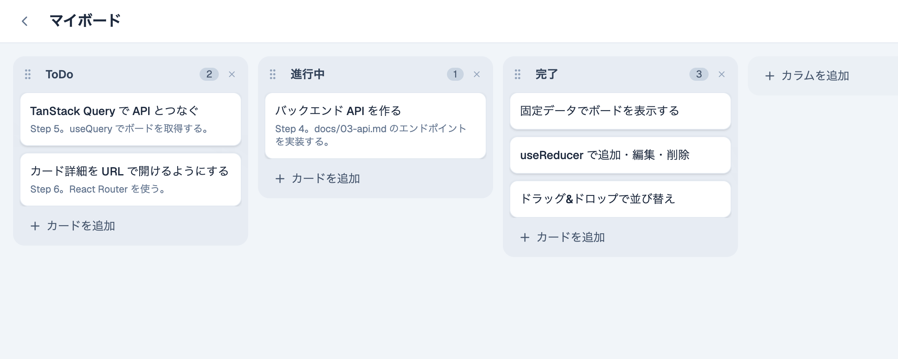
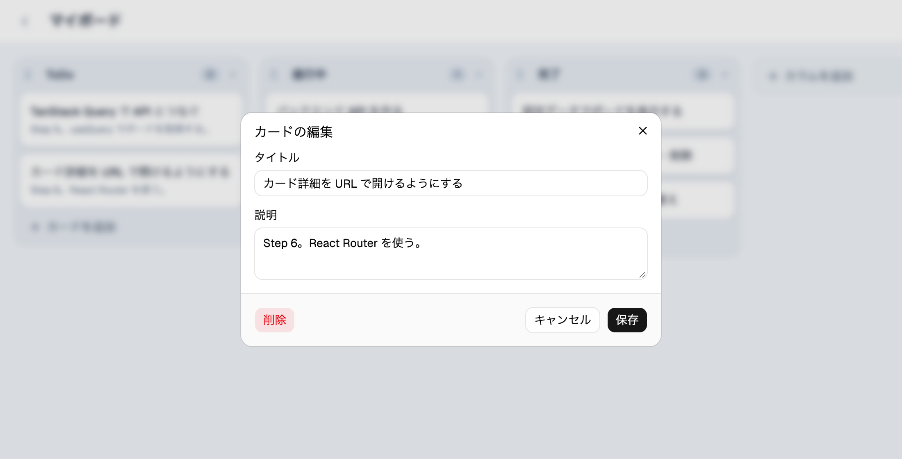
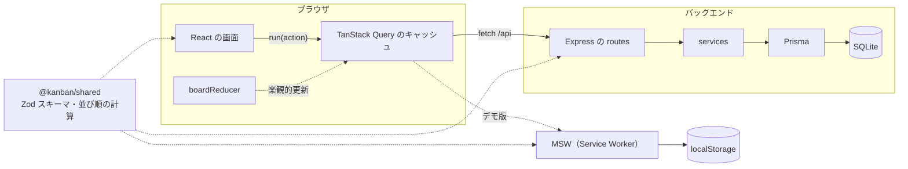

# かんばんボード

React 19 と TypeScript で作った、Trello のようなかんばんボード。React を学ぶ教材として、設計から完成までを6つの Step に分けて作っている。

[](https://github.com/kiyohara1021/kanban-board/actions/workflows/ci.yml)
[](https://github.com/kiyohara1021/kanban-board/actions/workflows/pages.yml)
[](LICENSE)


**デモ：https://kiyohara1021.github.io/kanban-board/**

インストール不要でそのまま触れる。デモ版では API をブラウザの中で再現しているので、データはそのブラウザにだけ保存され、ほかの人には見えない。



## 特徴

- カード・カラムの追加・編集・削除と、ドラッグ&ドロップでの並び替え（マウス・タッチ・キーボード）
- ボード一覧と、URL で開けるカード詳細（共有でき、再読み込みしても開いたまま）
- 操作は画面にすぐ反映し、裏でサーバーに保存する（楽観的更新）。失敗したら元に戻して通知する
- キーボード操作、スクリーンリーダーの読み上げ、日本語入力（変換中の Enter）に配慮
- フロントエンド・バックエンド・共有パッケージのテストを、Node.js 24 と 26 の CI で毎回実行

<details>
<summary>カード詳細の画面</summary>



</details>

## 技術スタック

| 分類              | 採用技術                                         | 選んだ理由                                                                       |
| ----------------- | ------------------------------------------------ | -------------------------------------------------------------------------------- |
| フロントエンド    | React 19 / TypeScript / Vite                     | 現在の標準的な構成で、資料が多い                                                 |
| UI                | Tailwind CSS v4 / shadcn/ui（Radix）             | 部品のコードが自分のリポジトリに入るので、読んで学べ、自由に直せる               |
| サーバーの状態    | TanStack Query                                   | 取得・キャッシュ・再取得・楽観的更新を任せられる                                 |
| ルーティング      | React Router v8                                  | 子ルートで、カード詳細を URL で表せる。ページごとにファイルを分けて読み込める    |
| エラー処理        | react-error-boundary                             | 描画中のエラーを受け止める部品を、クラスコンポーネントを書かずに使える           |
| ドラッグ&ドロップ | dnd-kit（`@dnd-kit/core` / `sortable`）          | 安定版で、キーボード操作と読み上げに対応している                                 |
| バックエンド      | Express 5 / Prisma 7 / SQLite（libsql）          | async の中のエラーを自動でまとめて扱え、DB の操作に型が付き、DB の準備がいらない |
| 共通              | Zod（`@kanban/shared`）                          | 入力の検証ルールと型を、フロントとバックで1か所にまとめられる                    |
| テスト            | Vitest / React Testing Library / Supertest / MSW | 単体・画面・API をそれぞれ、利用者に近い形で試せる                               |
| 品質管理          | oxlint / Prettier / GitHub Actions / Dependabot  | 速い lint と自動整形、2つの Node.js での CI、依存パッケージの更新を自動化        |

## 設計で工夫したところ

### 1つの reducer を、3つの場面で使い回す

ボードへの変更（カードの追加・移動など）は、すべて `boardReducer` のアクションとして表している。アクションの形を API と揃えたことで、同じ reducer を次の3か所で使える。

1. **Step 2〜3**：画面の状態を `useReducer` で管理する
2. **Step 5**：API の結果を待たずにキャッシュを書き換える（楽観的更新）。失敗したら元に戻す
3. **ドラッグ中**：カラムをまたいだ移動を、ドロップ前から画面に映す

画面からは `run(action)` を呼ぶだけで、画面の更新と API の呼び出しが行われる（[useBoardAction.ts](frontend/src/features/boards/useBoardAction.ts)）。

### ルールをフロントとバックで共有する

文字数制限などの入力ルールは Zod のスキーマとして `shared/` に1つだけ書き、バックエンドはリクエストの検証に、フロントエンドは型とフォームの制限に使う。並び順の計算（[position.ts](shared/src/position.ts)）も共有し、画面の仮の並びと保存される値が必ず一致するようにしている。

### 並び順は小数で持つ

並び順を 1000, 2000, 3000… の小数で持ち、間に入れるときは中間の値（1500）にする。移動のたびに書き換えるのは1件だけで済み、隙間が狭くなりすぎたときだけ振り直す。

### キーボードと日本語入力でも使える

- ドラッグ&ドロップは Space で持ち上げ、矢印キーで動かし、Space で置ける。隣のカラムへの移動、ドロップ後のフォーカスの戻り先、日本語の読み上げまで対応した
- 名前の変更などで Enter を扱うときは、日本語入力の変換を確定する Enter を除外している

### デモ版はブラウザの中で API を再現する

GitHub Pages ではサーバーを動かせないので、デモ版では [MSW](https://mswjs.io/) の Service Worker が `/api` へのリクエストを受け取り、`localStorage` を DB として同じ API を再現する（[frontend/src/demo/](frontend/src/demo/)）。アプリのコードはデモ版と通常版で共通で、通常のビルドには MSW を含めない。

## 構成



```
kanban-board/
├── frontend/      React アプリ（Vite の react-ts テンプレートから作成）
├── backend/       API サーバー（Prisma 公式の Express テンプレートから作成）
├── shared/        フロントとバックで共有する Zod スキーマ・型・並び順の計算
├── docs/          設計ドキュメントと画像
├── .github/       CI、GitHub Pages への公開、Issue / PR テンプレート、Dependabot
├── AGENTS.md      AI エージェント向けの説明（CLAUDE.md、.github/copilot-instructions.md からも参照）
└── package.json   npm workspaces のルート
```

## ローカルで動かす

Node.js 24 以上が必要。推奨は最新の LTS である 26（`.nvmrc` に書いてある）。nvm や fnm を使っている場合は、`nvm use` などで切り替えられる。

```bash
npm install
npm run db:migrate -w backend   # 初回だけ。SQLite の DB（backend/prisma/dev.db）を作る
npm run db:seed -w backend      # サンプルのボードを入れる（実行するたびにサンプルの状態に戻る）
npm run dev                     # フロントとバックを同時に起動する
```

http://localhost:5173 を開く。

| コマンド                       | 内容                                                                  |
| ------------------------------ | --------------------------------------------------------------------- |
| `npm test`                     | 3つのパッケージのテスト（Vitest。backend は Supertest で API を試す） |
| `npm run build`                | フロントのビルドと、3つのパッケージの型チェック                       |
| `npm run build:demo`           | GitHub Pages 用のデモ版をビルドする（`frontend/dist`）                |
| `npm run lint`                 | lint（oxlint）                                                        |
| `npm run format`               | 整形（Prettier）。`format:check` は確認だけ                           |
| `npm run db:studio -w backend` | ブラウザで DB の中身を見る（Prisma Studio）                           |

デモ版を手元で確かめるときは、`npm run build:demo` のあとに `npm run preview:demo -w frontend` を実行し、http://localhost:4173/kanban-board/ を開く。

## 学習者向けの進め方

React の学習に集中するため、最初はフロントエンドだけで作り、後から API とつなぐ順番にしている。各 Step が終わった時点にタグを付けているので、好きな Step の終わりから始めて、次の Step を自分で作り、完成形と見比べられる。

| Step | 内容                              | 主に学ぶこと                                                                      | 完成形のタグ        |
| ---- | --------------------------------- | --------------------------------------------------------------------------------- | ------------------- |
| 1    | 固定データでボードを表示する      | コンポーネント分割、props、リスト描画と `key`                                     | （`step-2` に含む） |
| 2    | カード・カラムの追加・編集・削除  | `useState` / `useReducer`、イミュータブルな更新、フォーム                         | `step-2`            |
| 3    | ドラッグ&ドロップで並び替え・移動 | dnd-kit、イベント処理、ネストした状態の更新                                       | `step-3`            |
| 4    | バックエンド API を作る           | Express、Prisma、Zod によるバリデーション                                         | `step-4`            |
| 5    | フロントと API をつなぐ           | TanStack Query、ローディング・エラー表示、楽観的更新                              | `step-5`            |
| 6    | ボード一覧とルーティング          | React Router（子ルート）、URL で状態を表す、画面のテスト（React Testing Library） | `step-6`            |

Step 1 は Step 2 と同じコミットに入っているため、タグは `step-2` から始まる。Step 1 から自分で作りたいときは、[設計ドキュメント](#ドキュメント)を読みながら新しいプロジェクトで作ってみる。

### 例：Step 3 を自分で作る

```bash
git clone https://github.com/kiyohara1021/kanban-board.git
cd kanban-board

# step-2 の状態から、自分用のブランチを作る
git switch -c my-step3 step-2
npm install
npm run dev
```

詰まったら、完成形と見比べる。

```bash
# Step 2 から Step 3 で変わったファイルの一覧
git diff --stat step-2 step-3

# 特定のファイルの変更
git diff step-2 step-3 -- frontend/src/pages/BoardPage.tsx

# 完成形のファイルを、今のブランチを変えずに見る
git show step-3:frontend/src/features/boards/useBoardDnd.ts
```

- タグによって使っているライブラリが違うので、切り替えたら `npm install` をやり直す
- `step-4` 以降は DB を使う。最初に `npm run db:migrate -w backend` と `npm run db:seed -w backend` を実行する
- 各 Step のコミットメッセージと設計ドキュメントに、その Step で決めたことやつまずいた点を書いてある

## ドキュメント

1. [要件・画面](docs/01-requirements.md)
2. [データモデル](docs/02-data-model.md)
3. [API 設計](docs/03-api.md)
4. [フロントエンド設計](docs/04-frontend.md)（各 Step で決めたこと、つまずいた点、デモ版の仕組み）
5. [バックエンド設計](docs/05-backend.md)

AI エージェント（Claude Code、Codex、Cursor、GitHub Copilot など）に作業させるときの説明は、[AGENTS.md](AGENTS.md) にまとめている。

### テンプレートから作ったもの

自分で書く必要のない部分は、公式のテンプレートや生成ツールを使っている。

| 対象                          | 使ったもの                                                                                                                      | 自分で変えたところ                                  |
| ----------------------------- | ------------------------------------------------------------------------------------------------------------------------------- | --------------------------------------------------- |
| `frontend/`                   | `npm create vite`（react-ts）                                                                                                   | サンプル画面の削除、Tailwind・パスエイリアス        |
| `frontend/src/components/ui/` | `npx shadcn add`（button, dialog, alert-dialog, input, textarea, label, sonner）                                                | 閉じるボタンの読み上げを日本語に変更                |
| `backend/`                    | `npx try-prisma --template orm/express`（[prisma-examples](https://github.com/prisma/prisma-examples/tree/latest/orm/express)） | PostgreSQL から SQLite に変更、構成を設計に合わせた |

## ロードマップ

[要件](docs/01-requirements.md)の「MVP の後に追加する候補」から選んで進める。

- [ ] ラベル（色付きタグ）
- [ ] 期限日と、期限切れの強調表示
- [ ] カードの検索・絞り込み
- [ ] ログインと複数ユーザー対応
- [ ] リアルタイム同期（WebSocket）

## 既知の問題・制限

- ログインの仕組みがないため、バックエンドは手元で動かす前提にしている。公開するデモはブラウザの中だけで動く
- カードやカラムを追加した直後、保存が終わるまでの短い間は画面で作った仮の ID を持つ。この間にそのカードを編集すると、保存に失敗する
- 同時に編集したときは、最後に保存したものが残る
- デモ版のデータはブラウザごとに保存されるため、別の端末や別のブラウザとは共有されない

## ライセンス

[MIT](LICENSE)

## 参考

- [kawamou/kanban-board](https://github.com/kawamou/kanban-board)：コンポーネントの分け方、カスタムフックへの切り出し方
- [braiekhazem/react-kanban-kit](https://github.com/braiekhazem/react-kanban-kit)：ID をキーにした平らなデータ構造（[フロントエンド設計](docs/04-frontend.md#別案正規化した状態)を参照）
- [alan2207/bulletproof-react](https://github.com/alan2207/bulletproof-react)、[shadcn-ui/taxonomy](https://github.com/shadcn-ui/taxonomy)、[gothinkster/realworld](https://github.com/gothinkster/realworld)：README の構成、公開デモの見せ方
