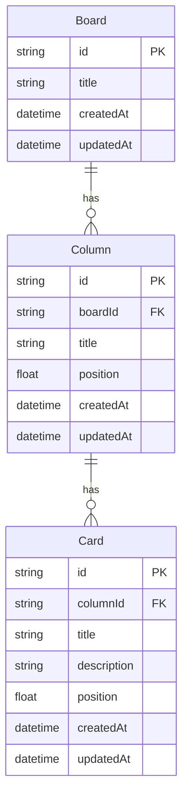

# 02. データモデル

## ER 図



- ボードを削除すると、配下のカラムとカードもまとめて削除する（カスケード削除）
- カラムを削除すると、配下のカードもまとめて削除する

## 項目ごとのルール

| モデル | 項目        | ルール                              |
| ------ | ----------- | ----------------------------------- |
| Board  | title       | 必須、1〜100文字                    |
| Column | title       | 必須、1〜50文字                     |
| Card   | title       | 必須、1〜100文字                    |
| Card   | description | 任意、0〜2000文字（未入力は空文字） |

ID は cuid（推測されにくい文字列）で、サーバー側で生成する。

## 並び順（position）の持ち方

カラムとカードの並び順は、小数の `position` で管理し、昇順に並べる。

```
カードA: 1000
カードB: 2000
カードC: 3000

C を A と B の間に移動 → C の position = (1000 + 2000) / 2 = 1500
末尾に追加           → 最後の position + 1000
先頭に追加           → 最初の position / 2
```

- **利点**：移動したカード1件を更新するだけで済む。0, 1, 2… の連番にすると、間に挿入するたびに後ろのカードをすべて更新する必要がある
- **注意点**：同じ場所への挿入を何度も繰り返すと、間隔がどんどん小さくなる。隣との差が `0.001` 未満になったら、そのカラムのカードを 1000, 2000, 3000… に振り直す

position の計算はサーバーで行う。クライアントは「どのカラムの何番目に移動したか（index）」だけを送る（[API 設計](03-api.md)を参照）。

## Prisma スキーマ（案）

```prisma
model Board {
  id        String   @id @default(cuid())
  title     String
  columns   Column[]
  createdAt DateTime @default(now())
  updatedAt DateTime @updatedAt
}

model Column {
  id        String   @id @default(cuid())
  boardId   String
  board     Board    @relation(fields: [boardId], references: [id], onDelete: Cascade)
  title     String
  position  Float
  cards     Card[]
  createdAt DateTime @default(now())
  updatedAt DateTime @updatedAt

  @@index([boardId, position])
}

model Card {
  id          String   @id @default(cuid())
  columnId    String
  column      Column   @relation(fields: [columnId], references: [id], onDelete: Cascade)
  title       String
  description String   @default("")
  position    Float
  createdAt   DateTime @default(now())
  updatedAt   DateTime @updatedAt

  @@index([columnId, position])
}
```

## 今後の拡張（MVP の後）

- `Label` テーブルと、`Card` との多対多の中間テーブル `CardLabel`
- `Card.dueDate`（期限日、null 可）
- `User` テーブルと、`Board.ownerId`
