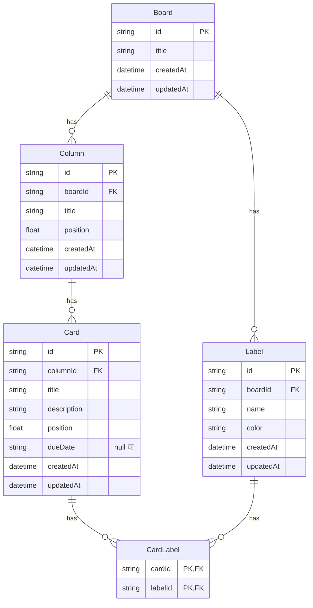

# 02. データモデル

## ER 図



- ボードを削除すると、配下のカラム・カード・ラベルもまとめて削除する（カスケード削除）
- カラムを削除すると、配下のカードもまとめて削除する
- ラベルはボードごとに持つ。カードとラベルは多対多（1枚のカードに複数のラベル、1つのラベルを複数のカードに付けられる）なので、中間テーブル `CardLabel` でつなぐ。主キーは `cardId` と `labelId` の組で、同じラベルを同じカードに2回付けることはできない
- カードかラベルを削除すると、`CardLabel` の行も削除する（付けていたラベルが外れる）

## 項目ごとのルール

| モデル | 項目        | ルール                                                 |
| ------ | ----------- | ------------------------------------------------------ |
| Board  | title       | 必須、1〜100文字                                       |
| Column | title       | 必須、1〜50文字                                        |
| Card   | title       | 必須、1〜100文字                                       |
| Card   | description | 任意、0〜2000文字（未入力は空文字）                    |
| Card   | dueDate     | 任意、`YYYY-MM-DD` 形式の実在する日付（未設定は null） |
| Label  | name        | 必須、1〜30文字                                        |
| Label  | color       | 必須、下の6色のどれか                                  |

ラベルの色は、画面での見た目（Tailwind CSS のクラス）ではなく、`green` のような色の名前で保存する。見た目を変えても DB を書き換えずに済む。

| color    | 画面での名前 |
| -------- | ------------ |
| `green`  | 緑           |
| `yellow` | 黄           |
| `orange` | オレンジ     |
| `red`    | 赤           |
| `purple` | 紫           |
| `blue`   | 青           |

ID は cuid（推測されにくい文字列）で、サーバー側で生成する。

## 期限日（dueDate）の持ち方

期限日は時刻を持たない「日付だけ」の値なので、`DateTime` ではなく `"2026-11-05"` のような文字列（`String?`）で持つ。

- **タイムゾーンで1日ずれない**：`DateTime` で持つと、日本時間の「11月5日 0時」は UTC では「11月4日 15時」になる。どの時刻を入れるか、どのタイムゾーンで日付に戻すかを毎回考える必要があり、間違えると表示が1日ずれる。文字列なら、入力した日付がそのまま保存され、そのまま返る
- **API・画面と同じ形**：`<input type="date">` の値も `"2026-11-05"` の形なので、変換せずにそのまま送れる
- **文字列のまま比べられる**：`YYYY-MM-DD` は桁数がそろっているので、文字列の大小と日付の前後が一致する。「期限切れか」は `dueDate < 今日` で判定できる
- SQLite には日付だけを表す型がないので、DB の中では文字列で持つことになる。形式（`YYYY-MM-DD` で、2月30日のような存在しない日付ではないこと）は Zod のスキーマ（`shared/src/schemas.ts`）で確かめる
- 期限日を設定しないカードもあるので、null を許す。空文字ではなく null にして、「設定していない」ことをはっきり表す

## 並び順（position）の持ち方

カラムとカードの並び順は、小数の `position` で管理し、昇順に並べる。

```
カードA: 1000
カードB: 2000
カードC: 3000

C を A と B の間に移動 → C の position = (1000 + 2000) / 2 = 1500
末尾に追加           → 最後の position + 1000
先頭に追加           → 最初の position / 2
```

- **利点**：移動したカード1件を更新するだけで済む。0, 1, 2… の連番にすると、間に挿入するたびに後ろのカードをすべて更新する必要がある
- **注意点**：同じ場所への挿入を何度も繰り返すと、間隔がどんどん小さくなる。隣との差が `0.001` 未満になったら、そのカラムのカードを 1000, 2000, 3000… に振り直す

position の計算はサーバーで行う。クライアントは「どのカラムの何番目に移動したか（index）」だけを送る（[API 設計](03-api.md)を参照）。

## Prisma スキーマ

```prisma
model Board {
  id        String   @id @default(cuid())
  title     String
  columns   Column[]
  labels    Label[]
  createdAt DateTime @default(now())
  updatedAt DateTime @updatedAt
}

model Column {
  id        String   @id @default(cuid())
  boardId   String
  board     Board    @relation(fields: [boardId], references: [id], onDelete: Cascade)
  title     String
  position  Float
  cards     Card[]
  createdAt DateTime @default(now())
  updatedAt DateTime @updatedAt

  @@index([boardId, position])
}

model Card {
  id          String      @id @default(cuid())
  columnId    String
  column      Column      @relation(fields: [columnId], references: [id], onDelete: Cascade)
  title       String
  description String      @default("")
  position    Float
  // 期限日。"2026-11-05" のような日付だけの文字列。未設定は null
  dueDate     String?
  labels      CardLabel[]
  createdAt   DateTime    @default(now())
  updatedAt   DateTime    @updatedAt

  @@index([columnId, position])
}

model Label {
  id        String      @id @default(cuid())
  boardId   String
  board     Board       @relation(fields: [boardId], references: [id], onDelete: Cascade)
  name      String
  // green / yellow / orange / red / purple / blue のどれか。SQLite は enum を使えないので、Zod で確かめる
  color     String
  cards     CardLabel[]
  createdAt DateTime    @default(now())
  updatedAt DateTime    @updatedAt

  @@index([boardId])
}

// カードとラベルの中間テーブル（多対多）。同じ組み合わせは1行だけ
model CardLabel {
  cardId  String
  card    Card   @relation(fields: [cardId], references: [id], onDelete: Cascade)
  labelId String
  label   Label  @relation(fields: [labelId], references: [id], onDelete: Cascade)

  @@id([cardId, labelId])
  @@index([labelId])
}
```

- SQLite では Prisma の `enum` を使えないので、`color` は文字列で持ち、6色のどれかであることは Zod のスキーマ（`shared/src/schemas.ts`）で確かめる
- Prisma は、`@relation` に何も書かない多対多（暗黙の中間テーブル）も作れる。ここでは中間テーブルを自分で書き、「カードとラベルをつなぐ行」が DB の中でどう表されるかを見えるようにした

## 今後の拡張（MVP の後）

- `User` テーブルと、`Board.ownerId`
